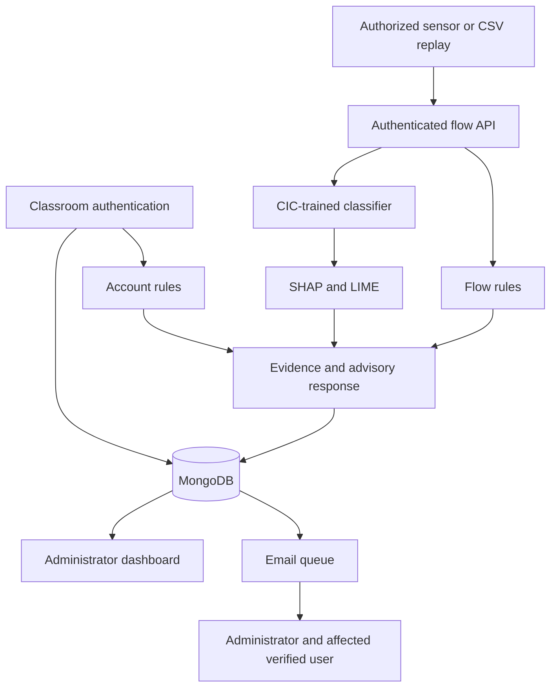

# Explainable Classroom Security — MongoDB edition

B.Tech cybersecurity prototype: classroom website, account monitoring, CIC-IDS2017 flow classification, SHAP/LIME, expert rules and advisory email alerts.

This edition uses **MongoDB through PyMongo**. It does not modify the existing PostgreSQL deployment or migrate its users. No passwords, live records, SMTP credentials or raw datasets are included.

## Included

- React/Vite frontend and Flask backend; registration, verification, sessions, password hashing and CSRF protection.
- MongoDB persistence for users, progress, events, flows, alerts and email queue.
- Administrator-only alert dashboard; applicable notifications to the affected verified user.
- Saved CIC-IDS2017 decision tree, training code, historical results, SHAP and LIME.
- Expert rules, SMTP/local email delivery, website hooks and optional sensor adapter.
- Tests, Docker configuration and Vercel entrypoint/build files.

## Quick start

Requires Python 3.12, Node.js 24 and MongoDB Atlas or a local **replica set**. Standalone MongoDB is unsupported. See `DEPLOYMENT.md`.

From this folder:

```bash
python3.12 -m venv .venv
source .venv/bin/activate
pip install -r server/requirements-live.txt
npm --prefix client ci
npm --prefix client run build
cp .env.example .env
python -c "import secrets; print(secrets.token_hex(32))"
```

Edit `.env` with your `MONGODB_URI`, `MONGODB_DB`, generated `SESSION_SECRET` and `ADMIN_EMAIL`. For local use keep `PUBLIC_URL=http://127.0.0.1:5001`, `COOKIE_SECURE=0`, and `MAIL_MODE=outbox`.

```bash
set -a
source .env
set +a
cd server
python manage.py init-db
python manage.py create-admin --email YOUR_ADMIN_EMAIL
python manage.py serve --port 5001
```

Open `http://127.0.0.1:5001`. `ADMIN_EMAIL` sets the alert recipient; `create-admin` grants dashboard access. Use the same email for both. Ordinary users register through the website and do not need individual environment variables.

In another terminal activate the environment, load `.env`, enter `server`, and run `python manage.py mail --watch`. In `outbox` mode messages are saved to private `server/instance/outbox/*.eml`, not sent. Open the test user's verification message locally. For real email configure SMTP in `.env`, set `MAIL_MODE=smtp`, and restart both processes.

## Architecture



Login rules and CIC flow classification are separate paths. A login event is not a CIC flow. Flow-only alerts do not infer a registered user's identity.

## Training and evaluation

The saved model runs without raw data. To retrain, from `server`:

```bash
python -m security_app.train_upgrade --data-dir /path/to/MachineLearningCVE --output instance/model-upgrade
```

Review evaluation results before replacing the supplied model. Historical metrics are in `server/models/cic-tree/RESULTS.md`; these are not new MongoDB measurements. See `PROJECT_STATUS.md` for limitations and `VERIFICATION.md` for tests.

## GitHub

**Extract the ZIP first.** Upload the contents of `classroom-security-mongodb/` to your repository root, including `app.py`, `pyproject.toml`, `vercel.json`, `server/` and `client/`. GitHub does not unpack ZIP uploads. Preserve `.gitignore`; never upload `.env`, `instance/`, database dumps, personal traffic or `node_modules/`. See `VERCEL_SETUP.md` for deployment.
